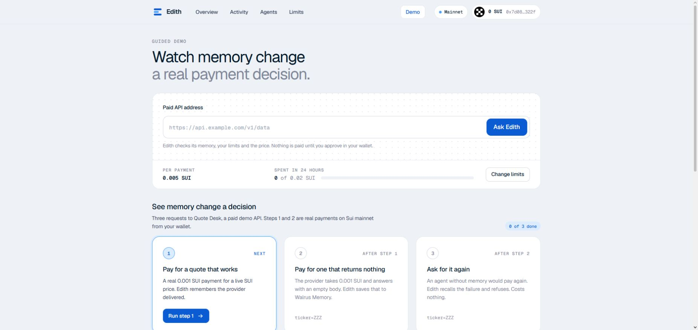
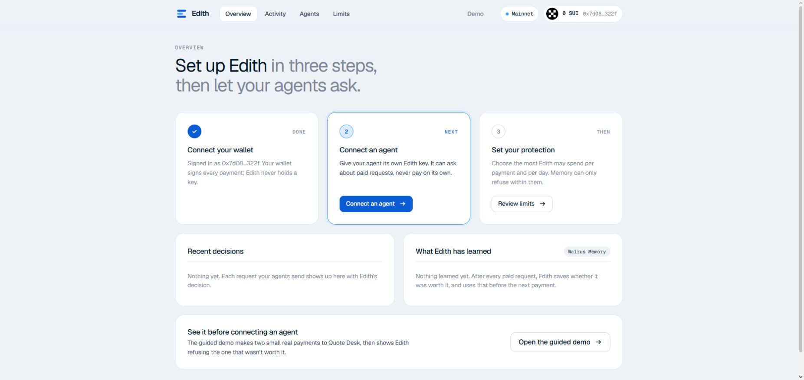
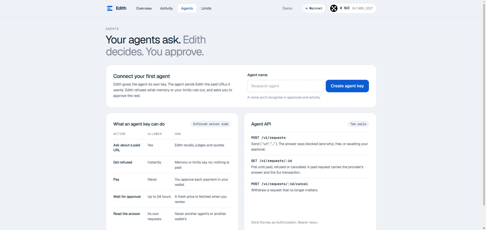
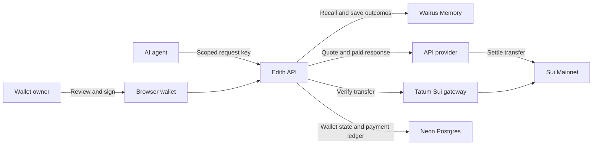

<div align="center">
  
  <h1>Edith</h1>
  <p><strong>Payment memory for AI agents.</strong></p>
  <p>Edith checks paid API requests against past outcomes and spending limits before asking you to approve them. Your wallet signs each payment; the agent only asks. Afterward, Edith verifies the transfer on Sui and records whether the response was worth paying for in Walrus Memory.</p>
  <p><a href="https://edith-sooty.vercel.app/app">Live app</a> · <a href="https://edith-sooty.vercel.app/app/demo">Guided demo</a> · <a href="docs/EVIDENCE.md">Mainnet evidence</a></p>
  <p> </p>
</div>

---

## Product preview

<p align="center">
  
</p>

<p align="center"><sub>The live guided demo. Its first two steps require wallet-approved Sui Mainnet payments; the third shows a memory-based refusal.</sub></p>

<table>
  <tr>
    <td width="50%"></td>
    <td width="50%"></td>
  </tr>
  <tr>
    <td align="center"><sub>Wallet, decisions, and memory</sub></td>
    <td align="center"><sub>Agent access, without spending authority</sub></td>
  </tr>
</table>

Screenshots were captured from the deployed app with a connected wallet. They show the setup state; the [recorded Mainnet run](docs/EVIDENCE.md) contains the payment and memory evidence.

## What Edith does

| Capability | In practice |
| --- | --- |
| **Memory before payment** | Recalls prior outcomes for the same wallet and endpoint. A known failed request can be refused before the provider is contacted. |
| **Owner-controlled spending** | Checks per-payment and rolling 24-hour limits before approval and again before sending a signed transfer. |
| **Wallet approval** | Shows the quote to the owner. An agent key cannot sign, submit, or approve a payment. |
| **Independent confirmation** | Verifies the completed Sui transfer through Tatum rather than relying only on the provider's response. |
| **Durable learning** | Saves paid outcomes to wallet-scoped Walrus Memory, then cites earlier evidence in later decisions. |
| **Reviewable activity** | Shows requests, decisions, transaction digests, and memory references in the app. |

## How it works

1. **Ask.** An agent sends a paid URL with its scoped Edith key. Edith reads memory, checks the URL and spending limits, and obtains a price.
2. **Decide.** A request is refused, returned as free, or held for the wallet owner's review. A fresh quote is fetched if the earlier one has expired.
3. **Approve.** The owner signs the exact SUI transfer in their wallet. Edith checks the signed payment's sender, recipient, and amount before forwarding it.
4. **Verify and remember.** Edith confirms the transfer on Sui through Tatum, judges the provider's response, and writes the outcome to Walrus Memory. The agent can then retrieve its result.

The [guided demo](https://edith-sooty.vercel.app/app/demo) uses Quote Desk to show a useful response, a paid empty response, and a repeat request refused from memory. Its two approved payments are **real Mainnet payments of 0.001 SUI each, plus network fees**. The repeat refusal costs nothing.

## Verified on Sui Mainnet

An [independently checked acceptance run](docs/EVIDENCE.md) recorded three wallet-approved payments and one repeat request refused without another wallet prompt or payment. The paid empty response and the later refusal refer to the same earlier failure.

| Outcome | Sui transaction | Walrus Memory |
| --- | --- | --- |
| Useful SUI quote | [View transaction](https://suiscan.xyz/mainnet/tx/x9Er8C5Lv7xZF1e5zhesMisWFvC9Qc7ognf1qxAJ7ur) | [View blob](https://walruscan.com/mainnet/blob/vC9lF2bSgZ57U01FnAXODqpD30f0_9AdB1a-F0XFxyc) |
| Paid empty ZZZ response | [View transaction](https://suiscan.xyz/mainnet/tx/CHn7z3JmjQF9GbFfrxuuHet7ADayz55Fcy9AHXoxp9b4) | [View blob](https://walruscan.com/mainnet/blob/pD3BkClaMcJop9tPYlsGI3WYATA6-HAmVR4LQfSKISk) |
| Repeat ZZZ request | Refused before payment | Cited the earlier paid failure |

The [evidence record](docs/EVIDENCE.md) includes the wallet, timestamps, verifier checks, and full run.

## Architecture



The static interface and serverless API run on **Vercel**. **Neon Postgres** stores wallet-scoped state, request history, spending reservations, and the provider's payment ledger. Walrus Memory stores outcome records; Sui is the payment source of truth.

## Tech stack

| Layer | Technology |
| --- | --- |
| Interface | Vanilla JavaScript, Vite, Sui Wallet Standard |
| API | Node.js 24, native ES modules, Vercel Functions |
| Payment verification | Sui SDK, Tatum Sui gRPC |
| Persistent memory | Walrus Memory (`memwal`) |
| Durable application state | Neon Postgres (`pg`) |

## Quick start

Requires **Node.js 24+**, a Sui wallet, Tatum access, and Walrus Memory credentials. Local development defaults to Sui Devnet; choose the network and provider address deliberately before any real payment.

```bash
git clone https://github.com/bunnyyxtan/edith.git
cd edith
npm ci
cp .env.example .env
# Fill in TATUM_API_KEY, MEMWAL_PRIVATE_KEY, MEMWAL_ACCOUNT_ID,
# SESSION_SECRET, SERVER_CHALLENGE_SECRET, and SUI_NETWORK in .env.
npm run setup:wallets   # creates the local demo provider's receiving address
npm run build
npm start
```

Open `http://localhost:4030`. Connect a wallet, create an agent key on **Agents**, and confirm spending limits before requesting a paid endpoint. The agent API accepts `POST /v1/requests` and `GET /v1/requests/:id` with `Authorization: Bearer <agent-key>`; see the [Agents screen](https://edith-sooty.vercel.app/app/agents) for the request shape.

For the hosted setup, Vercel needs the [production settings](.env.production.example), including `DATABASE_URL` from the **existing Neon integration**. The [rollout guide](docs/PAYMENT_ROLLOUT.md) covers payment holds and migration checks. Never commit a filled `.env` file.

## Security model

- **No custody:** the wallet owner signs each transfer; Edith does not hold their signing key. Agent keys can request and read their own results, but cannot pay.
- **Bounded spending:** per-call and rolling 24-hour limits are enforced server side with atomic reservations. An uncertain signed payment continues to count until its outcome is established with verifiable Sui evidence.
- **Conservative recovery:** historical payment holds require evidence-backed reconciliation. A missing provider response is not treated as proof that a payment failed.
- **Provider isolation:** external provider URLs must use HTTPS and resolve to public addresses. Redirects are not followed, and response size is capped, including decompressed content.
- **Scoped evidence:** memory and app state are separated by wallet; confirmed Sui digests and Walrus records accompany paid outcomes.

See [security implementation notes](docs/SECURITY_FIXES.md) and the [payment rollout guide](docs/PAYMENT_ROLLOUT.md) for operational details.

## Links

[Live app](https://edith-sooty.vercel.app/app) · [Guided demo](https://edith-sooty.vercel.app/app/demo) · [Mainnet evidence](docs/EVIDENCE.md) · [License](LICENSE)
